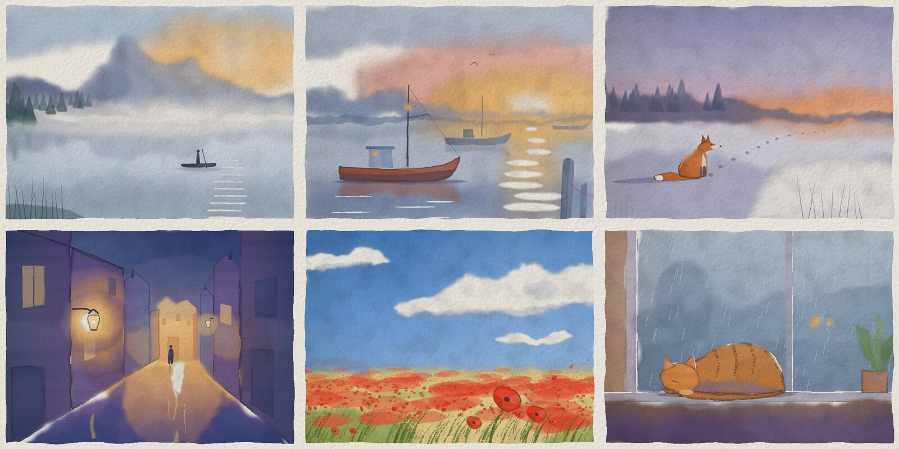
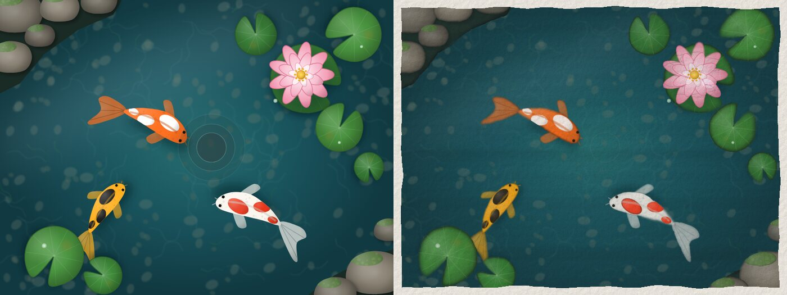
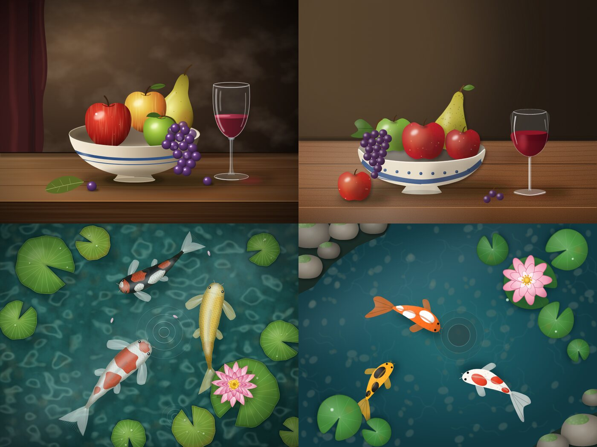

# pinsel

A text format for images that language models write. It compiles to SVG, and `style watercolor` paints the result as a watercolor.



```
pinsel 1 800 600
style watercolor
light top-right strength 0.35
color night 3e4a78

rect 0 0 800 200 wet gradient night 5f6493 90
rect 0 160 800 140 wet gradient 8f84ad d9a9a0 90

template fir h=40
  shape 0,-h! h*0.3,0! -h*0.3,0! color 34525c+z*20 corners
scatter fir 45 along 0,345 260,335 520,340 800,332 scale 0.5..1.1 depth
```

The full format fits on one page: [SPEC.md](SPEC.md).

## Why not SVG

Models write SVG reasonably well, but it works against them:

- Bezier control points have to be placed blind. pinsel lays a smooth curve through plain points, `!` marks a corner.
- Everything hangs on global coordinates. pinsel has named parts with their own origin, scale, rotation and mirroring.
- No variables, loops or templates. pinsel has `template`, `use`, `scatter` (sorted by depth) and `repeat`.
- Shading has to be built by hand, so most model-drawn SVG looks like clip art. In pinsel, one `light` line shades every shape.
- Indented shapes are clipped to their parent shape, so spots, stripes and folds stay inside.

## Watercolor

`style watercolor` is built from SVG filters, per shape: ragged edges, lost and found edges, a darker pigment rim, blooms, brush streaks, granulation that sits in the paper texture, a pencil underdrawing that shows through, and a deckled paper border. On top of that:

- `wet`: the paint flows and the outline frays. Wet shapes painted directly after each other bleed into each other.
- `reserve`: brings back the white of the paper, for glints, light beams and snow.
- `dry`: dry brush, the stroke breaks up in the paper grain.
- Light colors get no dark rim. Small shapes are distorted less, so they don't disappear.



The spec also tells the model how to paint a watercolor: light to dark, the paper is the white, one focal point, never black. That paragraph changed the results more than any filter.

## Usage

Requires Node 20+ and Chrome or Chromium for PNG output (`PINSEL_CHROME` sets the binary). ImageMagick is optional, the MCP server uses it to shrink large previews.

```sh
node cli.js png picture.pinsel            # picture.png
node cli.js png picture.pinsel out.png --svg out.svg
node cli.js svg picture.pinsel            # SVG only, no Chrome needed
node cli.js png drawing.svg               # rasterize any SVG
```

As a library:

```js
import { compile } from './pinsel.js';
const r = compile(text); // { ok: true, svg, width, height } or { ok: false, error: { line, message } }
```

### MCP server

`mcp.js` is a stdio MCP server without dependencies. It has two tools: `guide` returns the spec, `paint` renders pinsel text and returns the image, so the model can look at it and improve it. Images and sources are saved to `$PINSEL_DIR`, by default `<pictures folder>/pinsel`.

```sh
claude mcp add --scope user pinsel -- node /path/to/pinsel/mcp.js
```

Then ask for a picture, for example "paint a watercolor of a lighthouse in fog".

## Evaluation

Ten tasks, each drawn once in SVG and once in pinsel by the same model, with the same loop of render, look and fix (at most four renders). Details in [eval/](eval/).

| | SVG | pinsel |
|---|---|---|
| Quality | about even | about even |
| Source size, all ten images | 3.8 MB | 62 KB |



The SVG agents ended up writing generator scripts to produce their files. In pinsel the models wrote every image by hand.

## German

pinsel started out in German. The original keywords (`kreis`, `farbe`, `nass`, …) still work and can be mixed with the English ones, see [SPEC.de.md](SPEC.de.md).

## License

MIT
